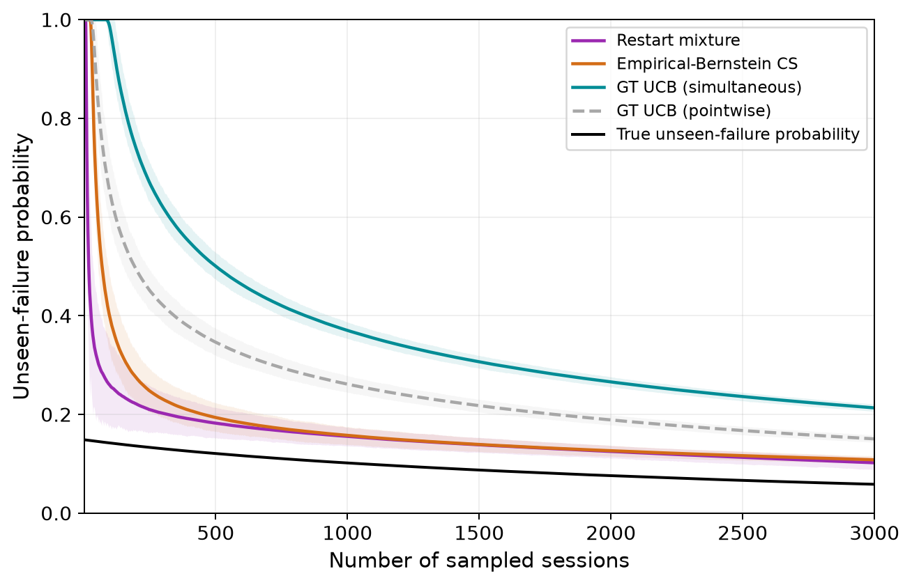

# Headline comparison: restarts and empirical-Bernstein

Canonical figures for the fixed-taxonomy SWE-Chat comparison, using the same
1,000 trials and 3,000 draws for every method.

**Main plot:** [headline_bounds.png](headline_bounds.png) · [publication PDF](headline_bounds.pdf)

**Restart ablation:** [plot](restart_ablation_bounds.png) · [publication PDF](restart_ablation_bounds.pdf)

| File | Contents |
|---|---|
| `headline_bounds.png` / `.pdf` | Main comparison: restart mixture, empirical-Bernstein, and Good-Turing bounds |
| `sequential_comparison.png` / `.pdf` | Magnified bounds, certification fractions, and truncated stopping costs |
| `restart_ablation_bounds.png` / `.pdf` | Secondary comparison: restart versus no restart, with the oracle |
| `coverage.png` / `.pdf` | Main comparison: empirical simultaneous coverage |
| `restart_ablation_coverage.png` / `.pdf` | Secondary comparison: restart versus no-restart coverage |
| `summary.json` | Settings, source hashes, coverage, and stopping results |
| `stopping.csv` | Paired stopping comparisons, including censored trials |

[Experiment specification](../../../../../experiments/empirical_bernstein_headline/spec.md)
· [Results and caption](../../../../../experiments/empirical_bernstein_headline/results.md)

Regenerate with `src/run_empirical_bernstein_headline.py` using
`configs/run_empirical_bernstein_headline.json`. Figures stay here; large trajectory
arrays stay under `artifacts/empirical_bernstein/primary_fixed_fullpop/`.
