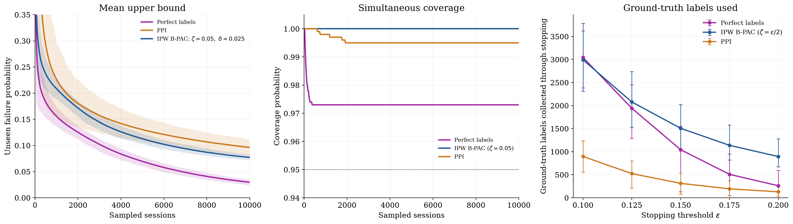

# Perfect labels, IPW B-PAC and PPI (r=0)

1,000 paired trials, Q=P, alpha=0.05, audit floor 0.10. [Exact specification](../spec.md).

**Stopping costs are now complete.** The 273 PPI trials at epsilon=0.10 that had not stopped by 10,000 sessions were continued using their original random streams. All stopped by 14,858 sessions. Exact replay of all stored prefixes was verified. Upper bounds and coverage still use the same 10,000-session window for every method.

[Ground-truth label-count figure](audit_cost.pdf) · [Caption](paper_caption.md)

| ε | Method | Mean sessions to stop | Mean ground-truth labels to stop | Mean categorizer calls to stop | Coverage through 10,000 |
|---|---|---:|---:|---:|---:|
| 0.1 | Perfect labels | 3,045.1 | 3,045.1 | 453.6 | 97.3% |
| 0.1 | IPW B-PAC | 6,167.9 | 2,993.9 | 1,561.5 | 100.0% |
| 0.1 | PPI, r=0 | 8,942.6 | 896.1 | 1,912.0 | 99.5% |
| 0.125 | Perfect labels | 1,942.4 | 1,942.4 | 289.6 | 97.3% |
| 0.125 | IPW B-PAC | 4,649.1 | 2,078.7 | 1,156.2 | 100.0% |
| 0.125 | PPI, r=0 | 5,234.9 | 524.7 | 1,119.8 | 99.5% |
| 0.15 | Perfect labels | 1,043.6 | 1,043.6 | 155.5 | 97.3% |
| 0.15 | IPW B-PAC | 3,484.2 | 1,507.8 | 856.7 | 100.0% |
| 0.15 | PPI, r=0 | 3,125.0 | 313.0 | 668.2 | 99.5% |
| 0.175 | Perfect labels | 508.9 | 508.9 | 75.6 | 97.3% |
| 0.175 | IPW B-PAC | 2,627.1 | 1,137.9 | 642.2 | 100.0% |
| 0.175 | PPI, r=0 | 1,941.0 | 194.6 | 414.8 | 99.5% |
| 0.2 | Perfect labels | 261.5 | 261.5 | 38.6 | 97.3% |
| 0.2 | IPW B-PAC | 2,000.8 | 894.7 | 488.5 | 100.0% |
| 0.2 | PPI, r=0 | 1,288.8 | 129.5 | 275.2 | 99.5% |

All costs are empirical averages over all 1,000 trials, each followed to its stopping time. No censored runs are excluded. B-PAC audit totals include all forced high-uncertainty audits and randomized audits below its threshold. Categorizer calls are separate.

Lines show means. Upper-bound shading and label-count error bars show empirical 2.5th–97.5th percentiles across trials. These describe trial variability, not confidence intervals for means or simultaneous confidence bands. Perfect/PPI appear once because their bounds do not depend on epsilon. The upper-bound and coverage panels show one B-PAC process with fixed (zeta,delta)=(0.05,0.025). The label-count sweep uses zeta=epsilon/2, delta=0.025.

Stopping tolerance violations: perfect labels 1 at epsilon=0.10 and 5 at 0.125; PPI 2 at 0.125; B-PAC none. No additional stopping violations among the continued PPI trials. These overlapping threshold comparisons are not independent.

The categorizer is assumed correct. PPI audit savings do not necessarily imply lower total cost because it can process more sessions and request more categorizations. The initial failure mass is 738/4961 ≈ 0.1488, so thresholds above this do not require discovering most categories.
